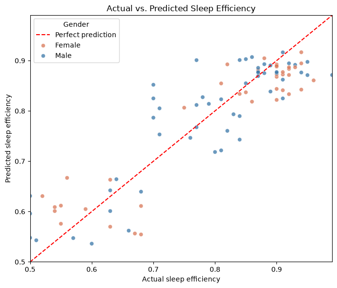

# Sleep Efficiency Prediction Using Multiple Linear Regression

A team mini-project that uses multiple linear regression to predict sleep efficiency from sleep and lifestyle data.

## Team and roles

**Group 37**

| Team member | GitHub handle | Entry number | Role |
|---|---|---|---|
| Dadhaniya Aryan Ketanbhai | [@DadhaniyaAryan](https://github.com/DadhaniyaAryan) | 2026MCB1523 | Execution Lead |
| Shisti Upendra | [@ShistiUpendra](https://github.com/ShistiUpendra) | 2026EEB1410 | Documentation Lead |
| Viraj Amit Bapat | [@virajiitrpr](https://github.com/virajiitrpr) | 2026ESB1499 | Video Lead |
| Prateek | [@prateek-1069](https://github.com/prateek-1069) | 2026AIB1069 | PPT Lead |

All team members contributed to the code and committed using their own GitHub accounts.

## Project structure

```text
sleep-efficiency-regression/
├── .gitignore
├── README.md
├── requirements.txt
├── main.ipynb
├── output.png
└── data/
    └── Sleep_Efficiency.csv
```

## Dataset

The dataset contains 452 rows and 15 columns. The CSV is included in data/, so cloning the repository downloads it; no separate download is needed.

- *Source:* [Sleep Efficiency dataset on Kaggle](https://www.kaggle.com/datasets/equilibriumm/sleep-efficiency/data)


## Setup and run

**Python requirement:** Python 3.11–3.14 (inclusive). Check your installed version before continuing.

Follow the commands for your operating system from top to bottom line by line. They create a virtual environment and use its Python directly.

### Windows (PowerShell)

Open PowerShell and run:

```powershell
git clone https://github.com/DadhaniyaAryan/sleep-efficiency-regression
cd sleep-efficiency-regression
python --version
python -m venv .venv
.\.venv\Scripts\python.exe -m pip install -r requirements.txt
.\.venv\Scripts\python.exe -m jupyter nbconvert --to notebook --execute --inplace main.ipynb
.\.venv\Scripts\python.exe -m jupyter trust main.ipynb
.\.venv\Scripts\python.exe -m notebook main.ipynb --ServerApp.open_browser=True
```

### macOS /Linux (Terminal)

Open Terminal and run:

```bash
git clone https://github.com/DadhaniyaAryan/sleep-efficiency-regression
cd sleep-efficiency-regression
python3 --version
python3 -m venv .venv
.venv/bin/python -m pip install -r requirements.txt
.venv/bin/python -m jupyter nbconvert --to notebook --execute --inplace main.ipynb
.venv/bin/python -m jupyter trust main.ipynb
.venv/bin/python -m notebook main.ipynb --ServerApp.open_browser=True
```

The execution command runs all notebook cells and saves their results in main.ipynb. The trust command marks those locally generated outputs as trusted. The final command opens the notebook in your browser.

### Common errors and fixes

- **Python not found:** Install Python 3.11–3.14, then reopen the terminal.
- **Package installation fails:** Check your internet connection and rerun the pip install -r requirements.txt command above.
- **CSV file not found:** Run commands from the repository root and check that data/Sleep_Efficiency.csv exists.
- **Browser doesn’t open:** Copy the local http://127.0.0.1:... address from the terminal into your browser. Keep the terminal open.

## Expected output

| Evaluation | MAE | MSE | RMSE | R² |
|---|---:|---:|---:|---:|
| Test set (91 rows) | 0.0507 | 0.0039 | 0.0622 | 0.7919 |


**Expected-output screenshot:** 



## Slides and video

- *Slides:* 
- *Video:* 

## AI-use disclosure

ChatGPT assisted with project code and debugging, creating numeric time features from bedtime and wake-up times, formatting plots and the README, and preparing setup instructions for opening and running the notebook. A responsible team member reviewed the AI-assisted material and the final project before submission.